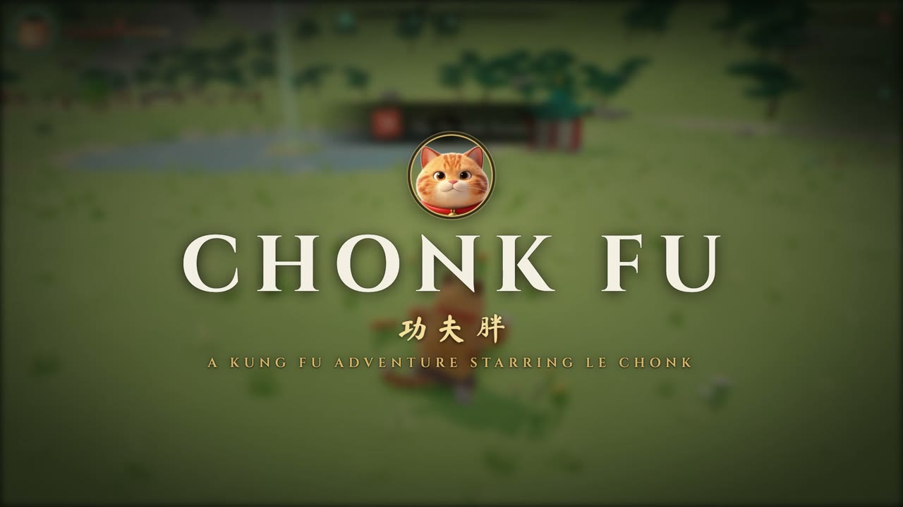
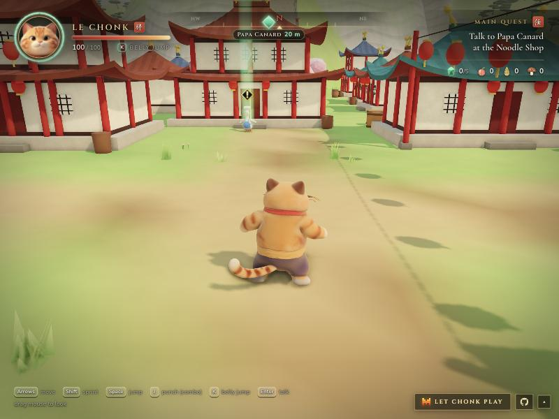
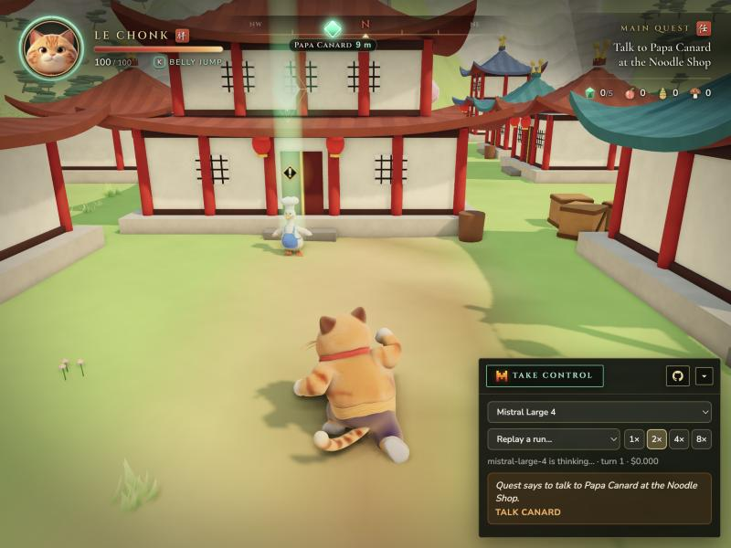
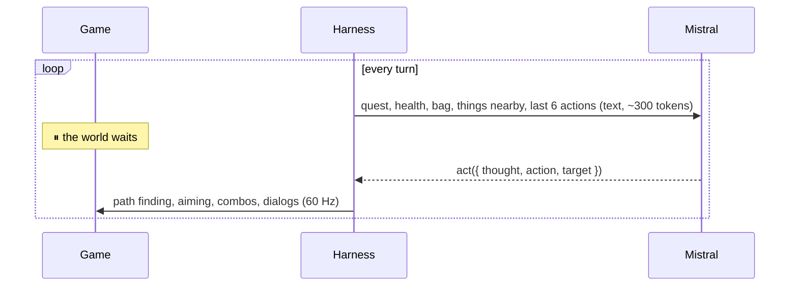

<p align="center"></p>

# CHONK FU

**A 3D kung fu adventure in the browser, starring Le Chonk. Mistral can play it for you.**

▶️ **Play:** https://goums.github.io/chonk-fu/ <br>
🎬 **Video (1 min 28 s):** https://goums.github.io/chonk-fu/video/chonk-fu.mp4

[](https://goums.github.io/chonk-fu/video/chonk-fu.mp4)



Wolf bandits ran through the Valley of Peace. A tiger called Overfit learned every kung fu move in the world. Le Chonk, a chubby orange cat, steps up.

- An open valley: village, palace on a mountain, bamboo forest, lotus pond, wolf camp.
- Smash crates and rocks, find the five Jade Stones, cook the Dragon Noodles, beat Overfit.
- A Training Arena with a coach and a sparring partner.
- Music and sounds are generated in code.
- English and French (EN / FR button, bottom right).

**Keys:** arrows move · Shift sprint · J punch · K belly jump · Space jump · Enter talk · M mute.

---

## 🤖 Mistral plays

Press **Let Chonk play** (bottom right). Mistral takes over from where you are. Press **Take control** to play again.





- **One action per turn:** `go`, `talk`, `hit`, `fight`, `sprint` or `wait`, on a target id.
- **Text only.** No images, so a whole game costs a few cents.
- **Exact replays.** The game is deterministic. Recorded runs replay from the panel.

| Mistral Large 4 | Completed | Game time | Turns | Cost |
|---|---|---|---|---|
| Run 1 | ✅ | 6:33 | 55 | $0.049 |
| Run 2 | ✅ | 5:26 | 49 | $0.043 |
| Run 3 | ✅ | 5:06 | 44 | $0.039 |

---

## Run it

```bash
npm install
npm run dev
```

Put `MISTRAL_STUDIO_API_KEY` in `.env` for the AI. On the website, paste your own key in the panel.

```bash
npm run play -- --model mistral-large-4   # a headless run, saved for replay
```

## Stack

three.js · TypeScript · Vite. Characters made with Hunyuan3D-2.1, rigged in Blender, animated with CC0 mocap. See [CREDITS.md](CREDITS.md).

The video is made with Remotion from replays of the recorded runs, the game's own music and a Voxtral TTS voice-over (`video/`, `npm run render`).
